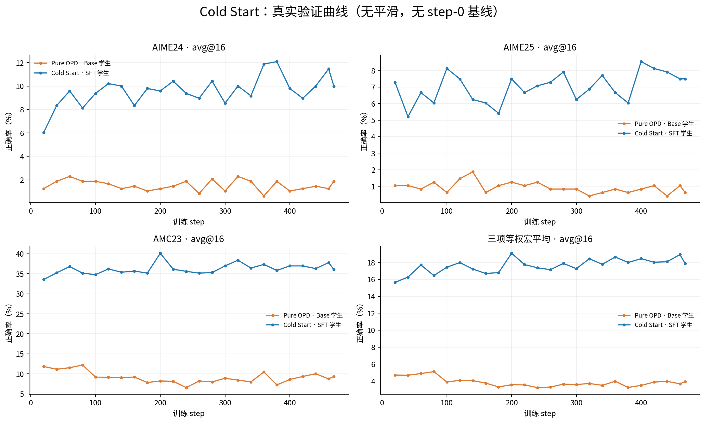
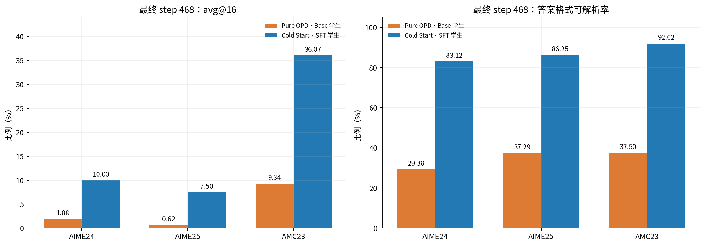
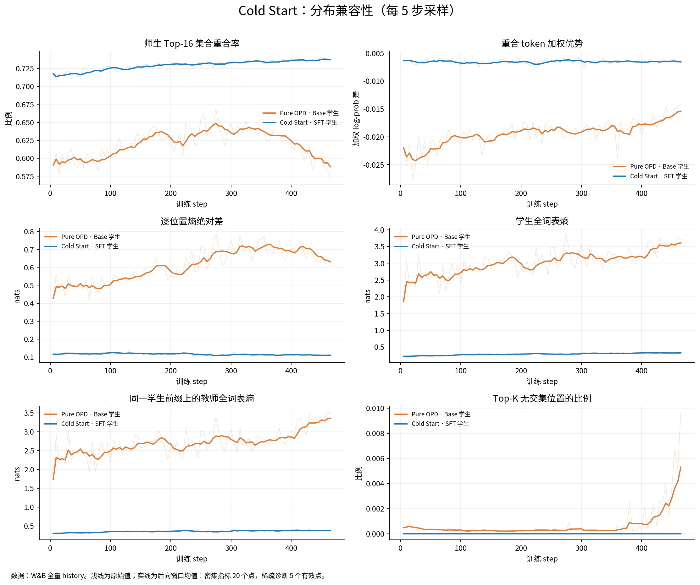
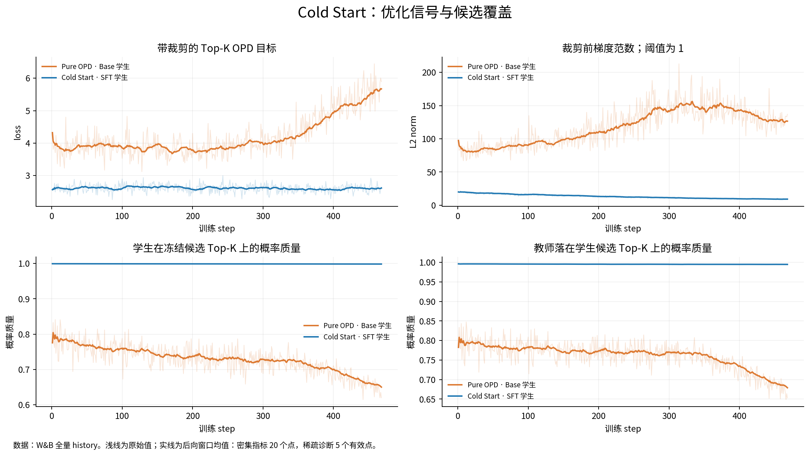
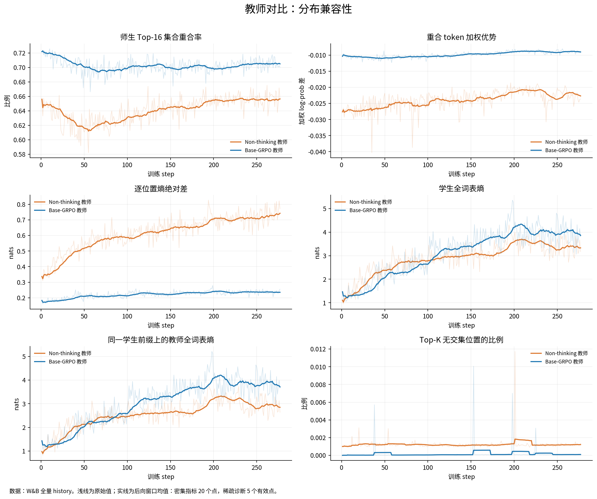
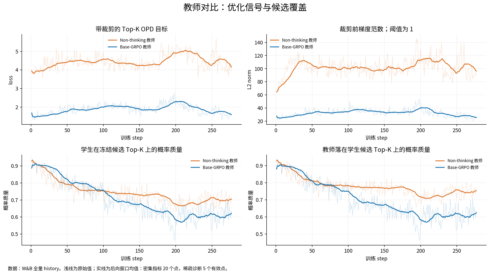
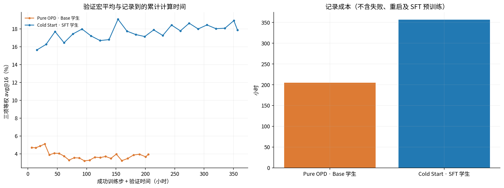

# OPD-Rethinker

**面向数学推理的 On-Policy Distillation 实验、师生分布诊断与 Cold Start 对照。**

本项目在分布式 GPU 环境中，围绕 Qwen3-1.7B 学生与 Qwen3-4B 教师开展四组 OPD 实验：比较教师后训练方式带来的分布差异，再比较 Base 与 SFT 学生初始化对蒸馏过程和数学验证结果的影响。仓库包含分布式训练适配、Student Top-K 蒸馏、动态诊断、启动脚本和实验图表。

本文数值与图片依据 **2026-10-07 的实验报告快照**整理；图片来自已有实验记录，没有重新运行训练。结论对应本项目的具体模型、数据和评测设置。

## 结果概览

- **Cold Start 的最终验证结果更高。** 在 step 468，AIME24、AIME25、AMC23 的 avg@16 分别为 **10.000%、7.500%、36.069%**，三项等权宏平均为 **17.856%**；Pure OPD 对应宏平均为 **3.946%**。
- **教师兼容性可以通过训练过程诊断。** 同一 Base 学生下，Base-GRPO 教师组后期 Top-16 重合率为 **0.7049**，高于 Non-thinking 组的 **0.6564**；逐位置熵差与裁剪前梯度范数也更低。
- **更好的效果伴随更高记录成本。** Cold Start 的成功训练与验证记录累计约 **356.90 小时**，Pure OPD 约 **205.09 小时**；不包含 SFT、失败启动和重启等待。

> Cold Start 与 Pure OPD 的最终差距包含 SFT 初始化已有能力。由于缺少 step 0 评测，不能将差距全部归因于后续 OPD；教师对照组缺少在线验证，也不能仅凭兼容性指标判断数学能力优劣。

## 实验设计

| 实验 | 学生初始化 | 固定教师 | OPD 训练数据 | 报告中的观测范围 |
| --- | --- | --- | --- | --- |
| E1 · Non-thinking 教师 | Qwen3-1.7B-Base | Qwen3-4B，Non-thinking | DAPO processed，17,917 条 | step 1–277；无在线验证 |
| E2 · Base-GRPO 教师 | Qwen3-1.7B-Base | Qwen3-4B-Base-GRPO | 同 E1 | step 1–277；无在线验证 |
| E3 · Pure OPD | Qwen3-1.7B-Base | Qwen3-4B，Non-thinking | OpenThoughts3 complement，30,000 条 | step 1–468；24 个验证节点 |
| E4 · Cold Start | Qwen3-1.7B-SFT | 同 E3 | 同 E3 | step 1–468；24 个验证节点 |

E1/E2 比较教师条件；E3/E4 比较学生初始化。两套实验的数据集不同，不能把四组当作同一数据上的完整四条件对照。Cold Start 指先使用 SFT 学生初始化，再开展 OPD。

## Cold Start：数学验证结果

### 验证曲线



每 20 步验证一次，并在最后 step 468 验证，共 24 个节点。图中使用原始验证值，不做平滑。`avg@16` 表示每题 16 次生成的正确率均值，再对题目平均；它不同于 pass@16，也不同于多数投票正确率。

评测采样为 temperature **0.7**、top-p **0.95**。AIME24、AIME25 各 30 题，AMC23 为 83 题。历史配置的 response 上限为 7,168 tokens；引擎上下文容量 32,768 不能当作已验证的 31K 回答长度协议。

### 最终 checkpoint：step 468

| 验证集 · avg@16 | Pure OPD | Cold Start | 差值（百分点） |
| --- | ---: | ---: | ---: |
| AIME24 | 1.875% | **10.000%** | +8.125 |
| AIME25 | 0.625% | **7.500%** | +6.875 |
| AMC23 | 9.337% | **36.069%** | +26.732 |
| 三项等权宏平均 | 3.946% | **17.856%** | +13.910 |

宏平均对三个 benchmark 等权，不按题目数合并。首次 step 20 的宏平均已经分别为 **4.705% / 15.639%**，说明两组在训练早期就存在明显差距。Cold Start 的最高宏平均出现在 step 200（19.073%）；上表统一报告最终 checkpoint，避免混用事后最优点。

### 正确率与答案格式分开观察



Cold Start 的最终 boxed 可解析率分别为 **83.125%、86.250%、92.018%**；Pure OPD 为 **29.375%、37.292%、37.500%**。格式可解析率衡量能否提取答案，不能替代数学正确率。最终性能差距同时包含输出格式与解题表现的差异。

## Cold Start：分布兼容性与优化过程



以下为后期 **step 449–468** 的 step 等权窗口均值；动态诊断每 5 步记录一次，因此该窗口中的动态指标只有 4 个有效记录点。

| 后期指标 | Pure OPD | Cold Start | 含义 |
| --- | ---: | ---: | --- |
| Top-16 overlap ratio | 0.5849 | 0.7373 | 师生高概率候选集合的重合程度 |
| 逐位置 entropy gap（nats） | 0.6319 | 0.1097 | 同一学生前缀上师生熵的绝对差 |
| 学生全词表熵（nats） | 3.638 | 0.3245 | 学生下一 token 分布的分散程度 |
| 学生候选概率质量 | 64.988% | 99.854% | 冻结 Top-K 候选覆盖的学生概率质量 |
| 教师在学生候选上的概率质量 | 67.909% | 99.474% | 同一候选集合覆盖的教师概率质量 |
| 裁剪前梯度范数 | 126.58 | 9.21 | 裁剪阈值为 1，两组均持续触发裁剪 |

Cold Start 在早期已经具有更高 overlap 和更小 entropy gap，后期仍保持较高概率覆盖。Pure OPD 则呈现熵、梯度范数和长度上升，固定 K=16 的候选质量下降。更低熵或更高覆盖率本身不证明解题能力更强，需与独立验证结果一起解释。



Pure OPD 的早期→后期蒸馏 loss 约 **3.815→5.671**，Cold Start 约 **2.589→2.614**。这里的 loss 是当前实现的候选蒸馏目标，不是数学错误率，也不是完整词表的标准师生 KL。

同一固定教师在两组中也可能呈现不同熵：教师评分的前缀由各自学生生成，访问到的状态不同，不代表教师权重发生变化。

## 教师对照：Non-thinking 与 Base-GRPO



E1/E2 使用相同 Base 学生和 DAPO prompt 集。下表为后期 **step 258–277** 的 20 点窗口均值。

| 后期指标 | Non-thinking 教师 | Base-GRPO 教师 |
| --- | ---: | ---: |
| Top-16 overlap ratio | 0.6564 | 0.7049 |
| 重合 token 加权优势 | -0.02266 | -0.00899 |
| 逐位置 entropy gap（nats） | 0.7424 | 0.2353 |
| 蒸馏 loss | 4.1608 | 1.6033 |
| 裁剪前梯度范数 | 96.33 | 25.49 |
| 学生候选概率质量 | 70.47% | 62.23% |

Base-GRPO 教师组的集合重合率更高、局部概率差异更小、梯度信号规模更低，但后期 Top-K 覆盖仍下降。这说明相对兼容性更好，与绝对概率分布变得更分散可以同时发生。



两组实际关闭在线验证（`test_freq=-1`、`val_before_train=False`）。上述结果支持训练过程中的分布兼容性差异，尚不能证明哪组最终数学正确率更高。

## 分布式实现与系统成本

训练采用 Student / Teacher 分离的资源调度。学生使用 FSDP、SP=2、BF16、动态 token 打包、参数与优化器 offload；固定权重的 HF teacher scorer 对学生轨迹分片前向评分。

```text
64 个 prompt × 每题 4 条学生轨迹
    → vLLM rollout
    → FSDP 重算旧概率、选 Student Top-K
    → 固定 Teacher scorer 对相同前缀打分
    → 学生反向传播、梯度裁剪
    → 同步新权重到 rollout
```

这些阶段存在同步数据依赖；rollout 使用 async 模式不意味着教师与学生训练彼此独立。

| 共同训练设置 | 实跑值 |
| --- | --- |
| prompt batch / rollout.n | 64 / 4，每步 256 条轨迹 |
| prompt / response 上限 | 1,024 / 7,168 tokens |
| OPD 模式 / K | `opd_student_topk` / 16 |
| 学生采样 | temperature=1.0，top-p=1.0，采样 top-k=-1 |
| AdamW 学习率 / 梯度裁剪 | 1e-6 / 1.0 |
| 蒸馏概率比裁剪 | 0.8–1.2，负优势 dual-clip=3 |
| 学生并行 | FSDP，SP=2 |
| 动态 token budget | 每 GPU 4,096 |
| 任务奖励 / reference KL | 关闭 |
| 数据与 actor shuffle | 均关闭，单 epoch |

采样 `top-k=-1` 表示不截断采样候选，与蒸馏选择 `K=16` 是不同设置。

### Cold Start 的计算代价

| 成本指标 | Pure OPD | Cold Start |
| --- | ---: | ---: |
| 平均训练 step | 25.07 分钟 | 45.10 分钟 |
| 学生更新均值 | 874.35 秒 | 1,681.20 秒 |
| 教师评分均值 | 85.91 秒 | 89.95 秒 |
| 有效 token 吞吐 | 27.72 tokens/s/GPU | 31.16 tokens/s/GPU |
| 成功训练记录累计 | 195.51 小时 | 351.78 小时 |
| 验证记录累计 | 9.58 小时 | 5.11 小时 |
| 合计记录时间 | 205.09 小时 | 356.90 小时 |

学生重算与更新占训练 step 的约 **83.3% / 89.6%**，是主要成本来源。Cold Start 处理的回答更长，token 吞吐更高与单步耗时更长并不矛盾。



成本统计不含 SFT、教师数据生成、失败启动与重启等待，也不是设备实际利用时长。两组教师资源布局存在差异，尚不能据此认定 Cold Start 的端到端性价比更高。

## 代码导航

| 路径 | 用途 |
| --- | --- |
| [compose.yaml](compose.yaml) | 训练容器及 Ray head 的部署配置 |
| [data/OPD/run_opd_verl09.sh](data/OPD/run_opd_verl09.sh) | 教师条件切换与 Student Top-K OPD 启动 |
| [data/OPD/run_opd_cold_start_verl09.sh](data/OPD/run_opd_cold_start_verl09.sh) | Base / SFT 初始化切换与日志镜像 |
| [data/verl](data/verl) | 当前启动脚本使用的 veRL 运行源码 |
| [data/OPD/verl09](data/OPD/verl09) | 另一份含 OPD 修改的 veRL 工作树；历史报告使用过此映射 |
| [teacher_scorer.py](data/verl/verl/experimental/opd/teacher_scorer.py) | 独立教师前向评分 |
| [distillation/losses.py](data/verl/verl/trainer/distillation/losses.py) | 蒸馏损失与诊断实现 |
| [check_ray_gpu_cluster.py](data/OPD/scripts/check_ray_gpu_cluster.py) | 检查 Ray 节点、GPU 可见性与 CUDA 初始化 |
| [sync_metrics_to_wandb.py](data/OPD/scripts/sync_metrics_to_wandb.py) | 持久化 JSONL 指标同步 |
| [docs/figures](docs/figures) | README 使用的实验曲线图 |

## 使用入口

通过 SSH 克隆仓库：

```bash
git clone git@github.com:lighter00x/OPD-Rethinker.git
cd OPD-Rethinker
```

运行前需准备兼容的 CUDA、PyTorch、vLLM、Ray 与数学判分依赖，并配置自己的数据目录和分布式资源。具体实验入口为：

| 入口脚本 | 选择变量 | 对应实验 |
| --- | --- | --- |
| `data/OPD/run_opd_verl09.sh` | `TEACHER_VARIANT=qwen3-4b` | E1 |
| `data/OPD/run_opd_verl09.sh` | `TEACHER_VARIANT=qwen3-4b-base-grpo` | E2 |
| `data/OPD/run_opd_cold_start_verl09.sh` | `STUDENT_VARIANT=base` | E3 |
| `data/OPD/run_opd_cold_start_verl09.sh` | `STUDENT_VARIANT=sft` | E4 |

模型权重、训练/验证数据、运行密钥和 checkpoint 需自行准备。启动脚本包含特定环境的默认设置，使用前需按自己的环境调整；当前默认值不能代替历史实跑配置。SFT 阶段的完整配置与数据去重清单尚未归档，不能仅凭本仓库完整复现 SFT→OPD 全链条。
